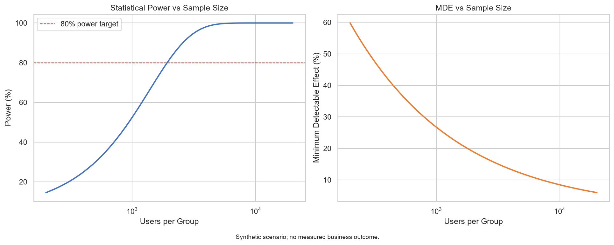
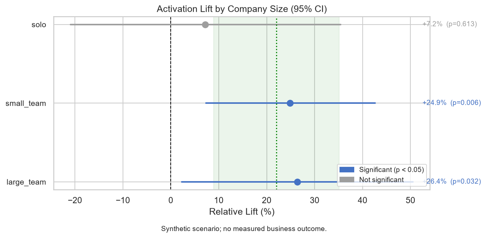
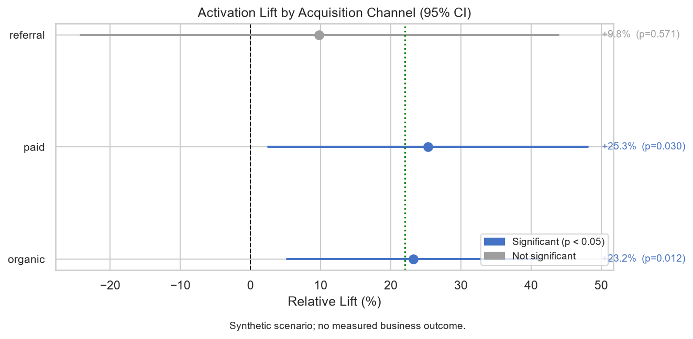
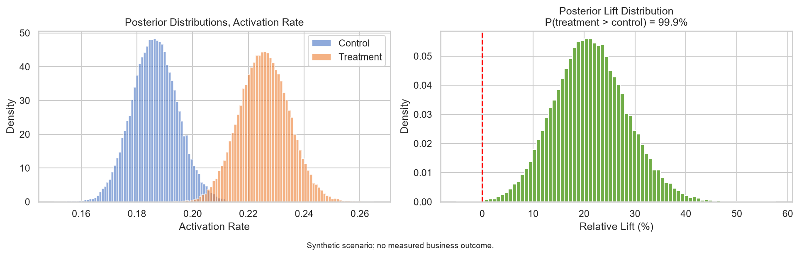
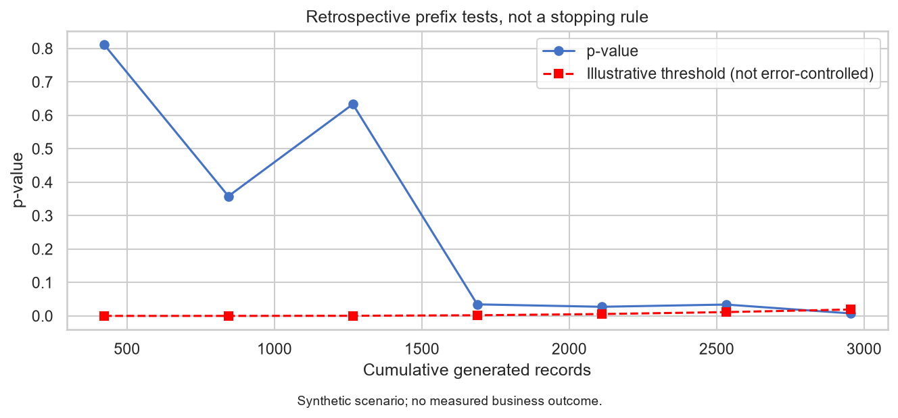

I built a Python framework to connect experiment planning, inference and decision-making. Its published run uses 4,230 synthetic user records for a hypothetical SaaS onboarding wizard. No real users were enrolled, no feature was shipped and no business improvement was measured.

The framework covers normal-approximation power planning, binary and continuous outcome tests, Beta-Binomial inference, exploratory segments, multi-covariate adjustment and a primary/secondary/guardrail scorecard. Auditing its outputs also exposed statistical and reporting limits that need to remain visible.

## Scenario and power planning

The generator plants a 25% population-relative activation effect, varying by company size, and a 4-percentage-point increase in day-1 drop-off. Revenue is zero-inflated and generated conditional on activation and a paid-conversion draw. Acquisition-channel labels do not affect the outcome equations.

For an assumed 18% baseline and 20% relative minimum detectable effect, two-sided alpha 0.05 and target power 80%, the normal-approximation sizing formula gives 1,923 records per arm. The saved sample has 2,115 per arm, including a nominal 10% buffer. This is planning arithmetic for generated data, not actual enrolment.

Synthetic scenario planning. Horizontal sample-size axes are logarithmic. The sizing calculation gives 1,923 records per arm; the related plotting functions use approximations. Detectable effect decreases approximately with the inverse square root of sample size, so doubling the sample does not halve the MDE.

The saved sensitivity table uses 1,923 per arm. The implemented approximate power calculation rises from about 80.1% at that N to 83.7% at 2,115 for the specified 20% effect. The generator scales the segment baseline profile to the requested baseline. The default profile has a weighted mean of 18%; individual clipping and latent quality mean a generated sample need not realise the requested rate exactly.

## Estimated effects in the saved sample

Generated control records have 395 activations among 2,115 records, or 18.6761%. Treatment has 482, or 22.7896%. The estimated difference is +4.1135 percentage points, equivalent to +22.03% relative lift. The fixed-horizon two-proportion z-test gives p = 0.000968, with an approximate 95% difference interval of +1.67 to +6.55 percentage points.

These estimates are distinct from the planted +25% relative effect. They demonstrate estimation under a known generator, not the effect of a real onboarding intervention.

Synthetic scenario. Estimated relative lifts are +26.4% for large_team, +24.9% for small_team and +7.2% for solo, with unadjusted p-values 0.0324, 0.0058 and 0.6132. Company-size differences are partly planted. A nonsignificant solo estimate does not establish no effect or equivalence.

Synthetic scenario. The saved notebook gives paid +25.3% (p = 0.0297), organic +23.2% (p = 0.0119) and referral +9.8% (p = 0.5706). Channel labels do not affect generated outcomes. These comparisons are exploratory and have no multiplicity correction or formal interaction test.

Prelisting segment dimensions does not remove multiple-testing concerns. The plotted relative intervals divide an absolute difference interval by the estimated control rate, without fully accounting for denominator uncertainty. They should not be treated as validated evidence for a segment rollout.

## Bayesian inference and revenue adjustment

The Bayesian implementation uses an assumed Beta(18,82) prior for each arm, with mean 18% and concentration 100. The saved 100,000-draw calculation gives P(treatment activation greater than control) = 99.93%, expected relative lift +21.32%, and a 95% relative-lift credible interval of +7.77% to +36.06%. These are conditional on the prior and Beta-Binomial model.

Synthetic scenario. Posterior distributions use the assumed Beta(18,82) prior. The separate ROPE rule uses an absolute difference of 0.5 percentage points as the practical threshold and returns treatment_wins in this generated sample. This is not a measured commercial benefit.

Generated revenue averages $2.8456 versus $3.2665 per synthetic record, an estimated +14.79% relative difference with Welch p = 0.326835. The uncertainty does not establish either a revenue benefit or no revenue effect.

Multi-covariate CUPED projects revenue onto two pre-experiment covariates. Saved pooled variance falls from 194.8082 to 186.3517, a 4.34% reduction. Under an equal-estimator variance approximation this corresponds to about 4.54% equivalent sample-size gain, not 4.34%.

Centring preserves the pooled mean, not the difference between arm means. The saved rounded confidence intervals shift from [-$0.42, +$1.26] to [-$0.33, +$1.31], implying contrasts near $0.42 and $0.49. The adjusted result remains nonsignificant. Stronger inference needs an explicitly justified treatment-adjusted estimator and variance calculation.

## Sequential visualisation and its limit

The sequential function slices already generated rows into cumulative batches. It compares each pointwise p-value with an O'Brien-Fleming-shaped cumulative spending expression. That is not a validated group-sequential boundary calculation, so the implementation does not establish overall alpha control.

Synthetic retrospective illustration. The saved execution crosses at look 7, after 2,954 records, about 69.8% of the generated sample. The current threshold implementation is not validated for repeated-testing error control. This is not evidence of actual experiment-time savings.

The saved calibration exercise runs 200 fixed-horizon tests under each generator setting, recording 8/200 null rejections and 157/200 rejections at the planned alternative. It does not exercise the stopping rule. Monte Carlo uncertainty and the distinction between fixed-horizon and sequential validation matter here.

## The decision the framework can support

Generated drop-off increases from 33.0496% to 38.3924%, a +5.3428-percentage-point difference, with p = 0.000288. The generator plants extra drop-off in every company-size group. It separately samples activation and drop-off, so these outputs do not demonstrate an observed funnel mechanism or establish that activation among survivors offsets abandonment.

The scorecard makes the tension visible: primary activation favours treatment, revenue is uncertain and the guardrail worsens. It does not justify an approved rollout to teams. A hypothetical follow-up would define acceptable harm, assess segment-level guardrails and confirm selected segments under a separate plan.

The project's value is the implemented workflow and inspectable saved artifacts. Improving it requires validated sequential boundaries, consistent planning formulas, explicit subgroup uncertainty, corrected CUPED reporting and versioned result exports. Those changes should precede stronger statistical or business claims.
